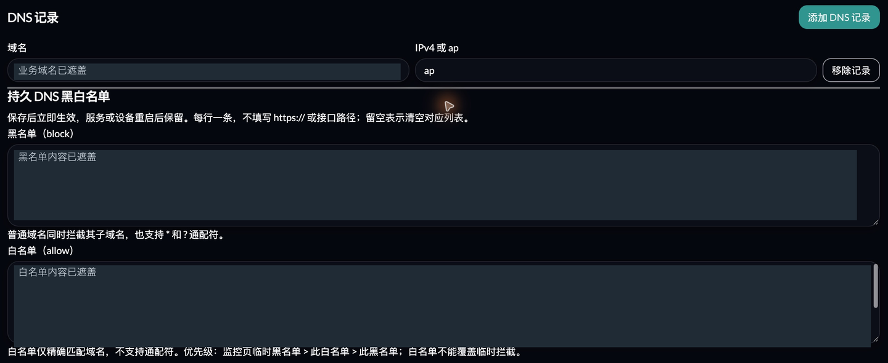
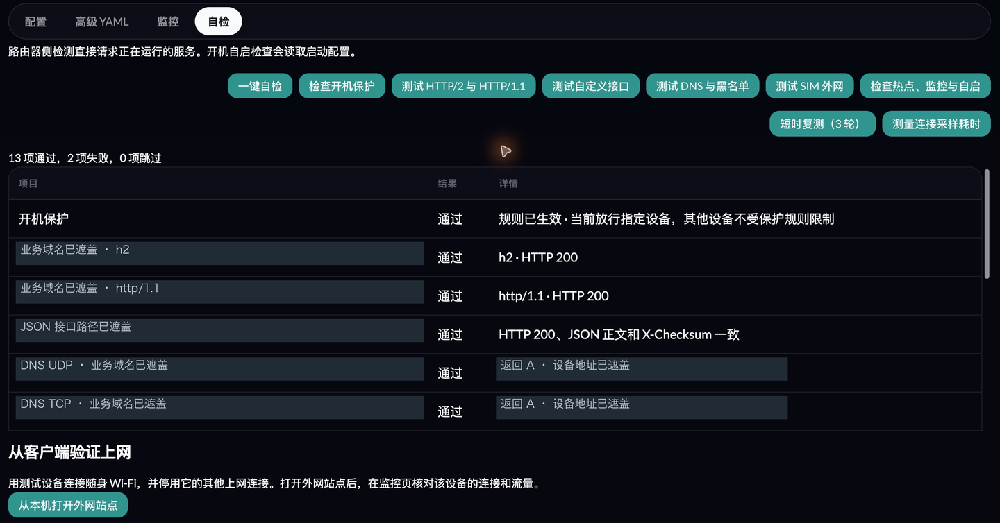

# FSD for OpenWrt

版本：1.7.0-r1。面向 ARM64 OpenWrt 的 DNS、HTTPS JSON 响应及 LuCI 管理服务。

## 功能

- DNS 记录、持久黑白名单、临时拦截和 DNS 查询监控。
- 多个 HTTPS 域名及各自的证书；支持 HTTP/2 和 HTTP/1.1。
- 完整接口路径匹配；`*` 匹配一段非空路径，精确规则优先。
- 按指定客户端 IPv4/IPv6 地址应用规则。
- 多套独立 YAML 配置：另存、复制、重命名、切换、删除及失败回退。
- 活动连接与域名筛选、诊断、自启和出网保护。

网络、热点及上游由 OpenWrt 管理。FSD 忽略旧配置中的 `wifi` 节点，保存或切换后不再写入。FSD 仍会按启用流程配置其 DNS 服务、监听端口和必要的防火墙规则。

## 实机界面

以下为 ZTE U30Air 上 FSD 1.7.0 的实机截图，使用 LuCI Aurora 主题。截图仅做裁剪、缩放和敏感信息遮盖；热点名、设备地址及业务域名未公开。不同 LuCI 主题的外观可能不同。

### 配置方案与作用设备

保存多套 YAML 配置，随时切换；可将规则限定到指定设备。


### DNS 记录与持久黑白名单

在可视化页面维护 DNS 记录、黑名单和白名单。



### 服务自检

检查 HTTPS、JSON 接口、DNS、网络及服务状态。截图保留当时的真实结果（13 项通过、2 项失败）；失败项为 SIM IPv6 和 Wi-Fi 热点检查，实际结果取决于设备当时的网络状态。



## 项目结构

| 路径 | 内容 |
|---|---|
| `src/` | Go 服务与单元测试 |
| `files/luci/` | LuCI 页面、RPC 入口和权限定义 |
| `files/` | 初始化服务、安装钩子、通用配置示例 |
| `scripts/build.py` | ARM64 编译及 APK/IPK 构建 |
| `tests/` | 包检查、生命周期、迁移及网络测试 |
| `Makefile` | OpenWrt SDK 软件包定义 |
| `install.sh` | 安装及迁移预检入口 |
| `THIRD_PARTY_LICENSES/` | 第三方依赖许可证 |

服务和程序名称为 `fsd-service`，软件包名称为 `luci-app-fsd`，RPC 对象为 `fsd`。配置位于 `/etc/fsd/`，管理 socket 为 `/var/run/fsd-service/fsd.sock`，防火墙表为 `fsd_service`。

## 构建

需要 Python 3、Docker，以及满足 `src/go.mod` 的 Go 工具链（当前声明 Go 1.27.4）。在项目根目录执行：

```sh
python3 scripts/build.py --go /path/to/go
python3 tests/inspect_packages.py
```

生成的 `dist/` 包含 Linux ARM64 程序、APK、IPK 和 SHA256SUMS；不要提交生成文件到源码仓库。APK 使用固定摘要的 Alpine 构建环境，构建需要访问镜像仓库及 Go 依赖源。

OpenWrt SDK 方式使用根目录 Makefile；其构建依赖预先生成的 `dist/fsd-service-linux-arm64`。

## 从下载安装包到首次使用

下面命令中 `192.168.50.1` 是示例路由器 LAN 地址，操作前替换为你自己的设备地址。网络名称、密码、SIM 上网均先在 OpenWrt 中配置好。

### 1. 确认设备条件

本版本不是固件，不能刷入，也不能安装在普通电脑或 Android 手机上。当前二进制只支持 Linux ARM64 / `aarch64_generic` 的 OpenWrt；APK 和 IPK 分别对应 apk、opkg 包管理器。

在设备 SSH 中检查：

```sh
uname -m
command -v apk
command -v opkg
uci get network.lan.device
uci get network.lan.proto
ip -4 addr show dev br-lan
```

应为 `aarch64`，至少有一个包管理器；LAN 使用 `br-lan` 和 `static`，且只有一个 IPv4 前缀。还需 firewall4/nftables、dnsmasq、LuCI、rpcd、uhttpd 等兼容组件，软件源需与固件匹配。其他架构、旧版 fw3/iptables 或不同 LAN 结构不能直接照本说明安装。

首次启用需要 5355、8444 端口空闲；53 可由 dnsmasq 使用，443 可由 uhttpd 使用。建议用网线或 USB 网络保持管理连接，避免首次启用调整 DNS/防火墙时失联。先在 LuCI 备份 OpenWrt 配置并下载到电脑。

### 2. 下载、解压和上传

普通用户下载 **FSD-OpenWrt-1.7.0.zip 安装包**，不需要源码包。先在电脑解压，确认目录中有：

```text
FSD-OpenWrt-1.7.0/
├── README.md
├── install.sh
└── dist/
    ├── luci-app-fsd-1.7.0-r1.apk
    ├── luci-app-fsd_1.7.0-1_aarch64_generic.ipk
    └── SHA256SUMS
```

把整个目录上传到设备 `/tmp/`。例如在电脑终端进入解压目录的上一级，再执行：

```sh
scp -O -r FSD-OpenWrt-1.7.0 root@192.168.50.1:/tmp/
ssh root@192.168.50.1
```

Windows 用户也可以用支持 SCP 的文件传输工具上传。`/tmp` 重启后会清空，这是安装文件的临时目录；安装后的配置不会保存在这里。

### 3. 安装插件

以下命令均在设备 SSH 中执行：

```sh
cd /tmp/FSD-OpenWrt-1.7.0
(cd dist && sha256sum -c SHA256SUMS)
```

校验必须全部为 `OK`。按设备实际包管理器更新软件索引，二选一：

```sh
apk update
# 如果使用 opkg，则执行：opkg update
```

再安装：

```sh
sh ./install.sh
```

脚本自动选择 APK 或 IPK，并先做迁移预检。缺少依赖时需要可用的软件源；遇到架构、内核依赖或迁移错误应先处理，不能强制覆盖。APK 为本地构建包，脚本只对指定文件使用 `--allow-untrusted`，不修改全局信任设置。

**首次安装后默认未启用。** 已启用的同名软件包升级后会重新启动服务。

### 4. 核对设备接口并启用

FSD 的默认 AP 配置节是 `ap0`，蜂窝逻辑接口是 `wan`，其他设备可能不同。先查看：

```sh
uci show wireless | grep -E '=wifi-iface|\.mode='
uci show network | grep '=interface'
uci show fsd
```

找到 `mode='ap'` 对应的无线配置节，以及实际蜂窝接口。这里使用 **UCI 配置节名称**，不是 `wlan0` 或 `sipa_eth8` 这样的网卡名。例如确认实际为 `ap0` / `wan` 后：

```sh
uci set fsd.main.ap_section='ap0'
uci set fsd.main.modem_interface='wan'
uci commit fsd
fsd-setup check
```

若 AP 节是匿名节，可填写类似 `@wifi-iface[0]` 的实际名称。上面的 fsd 设置仅指定 FSD 读取哪个接口，不会替你创建热点或蜂窝网络。

看到 `FSD prerequisites passed.` 后再执行：

```sh
fsd-setup enable
fsd-setup status
```

成功时会输出管理页面地址。首次 enable 会把 DNS 转发器移到 5355，FSD 使用 53，业务 HTTPS 使用 443，LuCI HTTPS 调整到 8444；同时配置 DHCP DNS 和必要的防火墙保护，关闭流量卸载。失败时尝试恢复本次修改前的设置。不要在启用过程中关闭管理连接。

### 5. 打开管理页面

用连接设备 LAN 的电脑或手机访问：

```text
https://192.168.50.1:8444/cgi-bin/luci/admin/services/fsd
```

使用 **OpenWrt/LuCI 的账号密码**登录，不是单独的 FSD 密码。默认管理证书为设备生成的自签证书；确认访问的是自己的设备后处理浏览器的证书提示。

也可以从 LuCI「服务 → FSD」进入。若刚升级看不到菜单或新按钮，退出重新登录，并强制刷新浏览器。

本安装包没有预设 VPN，也没有自动开放 8445。远程访问应先自行配置 VPN 和管理访问权限，不能直接把管理端口暴露到公网。

## 配置 DNS、HTTPS 和 JSON 接口

### 6. 先运行通用示例

首次启动包含演示域名 `fsd-install.home.arpa` 和 `/api/demo` 接口。可以直接在「自检」页测试 DNS、HTTPS 和 JSON。

客户端应使用设备作为 DNS 服务器；通常重新连接热点或更新 DHCP 租约即可获取。浏览器安全 DNS、客户端 DoH/DoT、其他 VPN 或缓存可能绕过这个 DNS 设置。

如客户端有 curl，可运行下面的演示测试（替换设备 IP）：

```sh
nslookup fsd-install.home.arpa 192.168.50.1
curl -k --noproxy '*' --resolve fsd-install.home.arpa:443:192.168.50.1 \
  https://fsd-install.home.arpa/api/demo
```

预期 DNS 返回设备 IP，curl 返回包含 `"ok":true` 的 JSON。`--resolve` 只验证 HTTPS 服务，不替代 DNS 测试；`-k` 仅用于这个自签证书测试，真实客户端仍须信任服务端证书。

### 7. 创建自己的配置

在「高级 YAML」中修改完整配置，先点校验，再保存并应用。以下是一个完整演示配置，`demo.home.arpa` 可替换为你的测试域名：

```yaml
version: 1
device_scope:
  mode: all
  addresses: []
dns:
  - name: demo.home.arpa
    ip: ap
h2_site:
  domain: demo.home.arpa
dns_blacklist:
  block: []
  allow: []
h2_routes:
  - path: /api/demo
    json: '{"ok":true,"message":"Hello from FSD"}'
  - path: /api/devices/*/status
    json: '{"enabled":true}'
```

各部分用途：

| 配置 | 用途 |
|---|---|
| `dns` | 把域名解析到指定 IPv4；`ap` 表示设备 LAN 地址 |
| `h2_site.domain` | HTTPS 服务接收的域名，应与对应 DNS 记录一致 |
| `h2_routes` | 匹配完整请求路径并返回配置的 JSON |
| `dns_blacklist.block` | 持久 DNS 黑名单，支持普通域名及 `*`、`?` 通配符 |
| `dns_blacklist.allow` | 精确域名白名单，不支持通配符 |
| `device_scope` | 规则作用于全部设备或指定客户端 |

路径 `/api/demo` 不匹配 `/x/api/demo`；`/api/devices/*/status` 可匹配 `/api/devices/123/status`，不能匹配多层的 `/api/devices/a/b/status`。区分大小写和末尾斜杠，精确规则优先。请求到达 FSD 后，未匹配接口返回 404，不会转发给原站。当前接口规则由各已配置 HTTPS 域名共用。

可视化编辑区可以修改设备范围、DNS、黑白名单和 JSON；域名与证书等完整设置在高级 YAML 中修改。不要同时保留两种编辑器的未保存草稿。

### 8. 只对指定客户端生效

例如在可视化页面选择「指定设备」，或将 YAML 对应部分改为：

```yaml
device_scope:
  mode: selected
  addresses:
    - 192.168.50.100
```

在 OpenWrt 中为该设备设置 DHCP 静态租约。若客户端使用 IPv6，也需填写实际 IPv6 地址；地址变化后需更新。经过其他路由器或代理转发时，FSD 可能只能看到转发方地址。

### 9. 配置黑白名单

例如：

```yaml
dns_blacklist:
  block:
    - '*.example.test'
  allow:
    - api.example.test
```

普通黑名单域名也会覆盖其子域名；白名单精确匹配。优先级为监控页临时黑名单 → 持久白名单 → 持久黑名单。临时黑名单不属于持久配置方案，服务重启后不会保留。DNS 拦截不能终止已经建立的连接，也不能直接阻止硬编码 IP 或绕过本机 DNS 的访问。

### 10. 使用自己的 HTTPS 证书

将证书和对应私钥安全上传到设备，例如 `/etc/fsd/certs/`，目录权限设为 700，私钥权限设为 600。证书须覆盖配置的域名，客户端还必须信任其签发者。不要把私钥粘贴进 YAML 或公开仓库。

```yaml
h2_site:
  domain: demo.home.arpa
  cert: /etc/fsd/certs/demo.crt
  key: /etc/fsd/certs/demo.key
```

`cert` 和 `key` 必须成对填写。若配置多个域名，用 `h2_sites` **替换** `h2_site`，两者不能同时存在：

```yaml
h2_sites:
  - domain: first.home.arpa
    cert: /etc/fsd/certs/first.crt
    key: /etc/fsd/certs/first.key
  - domain: second.home.arpa
    cert: /etc/fsd/certs/second.crt
    key: /etc/fsd/certs/second.key
```

同时为各域名添加对应 DNS 记录。这些证书用于业务 HTTPS，应答证书不等于 LuCI 管理页面的证书。未指定时使用自签证书；客户端如有证书固定校验，也可能拒绝连接。

## 多套配置方案

1. 保存当前表单或 YAML 修改。
2. 在页面顶部填写新名称，点击「当前配置另存为」。这里只创建副本，不自动切换。
3. 下拉选择方案，点击「切换并应用」。校验成功后生效，失败回退。
4. 编辑保存会写回当前方案。可复制或重命名所选方案，不能删除正在使用的方案。

首次运行将现有配置迁移为「默认方案」。每套 YAML 位于 `/etc/fsd/profiles/`；`/etc/fsd/config.yaml` 是当前方案的相对链接，正常重启保持选择。切换只影响 FSD，热点名称、密码、上游及 WireGuard 由 OpenWrt 管理。证书等外部文件共用，复制方案不会复制外部文件。

## 自检、升级、停用与备份

```sh
fsd-setup status
ubus call fsd checks '{"group":"all"}'
logread -e fsd-service
```

自检是设备侧测试，还应从目标客户端验证实际 DNS 和接口访问。热点关闭或 SIM 接口不可用会使对应项失败，不等于所有 FSD 功能都失败。

升级前备份整个配置目录，保留符号链接，并下载备份到电脑：

```sh
umask 077
tar -czf /tmp/fsd-backup.tar.gz /etc/fsd /etc/fsd-package /etc/config
```

若证书存放在其他目录，还需一并备份；备份可能包含密码和私钥，不可上传 GitHub。随后上传新安装包并运行新版 `install.sh`。软件包升级不会用示例覆盖已有方案和证书；目录迁移保留必要的兼容链接。

**需要恢复普通上网时使用停用命令，不要仅停止服务：**

```sh
fsd-setup disable
```

停用会恢复 FSD 管理的 DNS、防火墙和管理端口设置，保留用户之后的修改和业务配置。停用后管理页端口可能恢复到原来的 443。直接停止 `fsd-service` 可能触发出网保护，导致受保护客户端无法上网。

确认停用成功后，如需卸载，再按实际包管理器二选一：

```sh
apk del luci-app-fsd
# 或：opkg remove luci-app-fsd
```

## 常见问题

| 现象 | 处理方法 |
|---|---|
| 架构或依赖不匹配 | 确认 ARM64、包管理器和固件软件源；不要强装其他架构或不匹配内核依赖 |
| `Uncommitted UCI changes` | 在 LuCI 保存并应用或放弃待提交修改，然后重跑 check |
| `Set fsd.main.ap_section` / cellular interface 错误 | 按第 4 步填写实际 UCI 节名称 |
| LAN 不是 br-lan/static | 当前自动启用流程不支持此布局，先确认网络规划，不要盲目修改远程设备 |
| 端口占用 | 查找占用 53/443/5355/8444 的服务，解决冲突后再启用 |
| 管理页面打不开 | 使用实际 LAN IP、HTTPS 和 8444；确认在 LAN 内、服务已启用；查看 status 和日志 |
| DNS 解析未变化 | 核对客户端 DNS、作用设备 IP，重新连接热点或更新 DHCP，检查缓存及安全 DNS/VPN |
| HTTPS 证书错误 | 核对域名、证书/私钥及客户端信任；curl 的测试跳过校验不能解决客户端信任问题 |
| JSON 返回 404 | 检查完整路径、大小写、斜杠、单段通配符及当前方案 |
| 停止服务后无法上网 | 出网保护可能正在生效；要恢复原网络请执行 `fsd-setup disable` |
| 升级遇到目录冲突 | 保留两边配置和备份，先解决迁移冲突，不要强制覆盖或删除证书 |


## 测试

后端使用 Linux 专有网络接口，应在 Linux 环境运行：

```sh
cd src
go test ./...
```

带有网络命名空间和 nftables 副作用的测试默认跳过，仅在隔离测试环境启用。`tests/lifecycle.sh` 和 `tests/name-migration.sh` 会写入系统路径，只能在可丢弃容器中运行，不能在生产设备上直接执行。具体验证范围见 VALIDATION.md。

## 发布与隐私

此目录是独立源码副本，不含设备配置、私钥、证书、备份、日志、Git 历史或历史安装包。提交前仍应检查后续新增文件；`.gitignore` 不会移除已被 Git 跟踪的秘密。

项目自身尚未指定开源许可证，本次整理没有擅自授予授权。第三方依赖许可证保留在 THIRD_PARTY_LICENSES；如希望作为开源项目发布，请由权利人选择并加入项目许可证。

## 任何疑问请联系作者TG：@Amor_Paul
